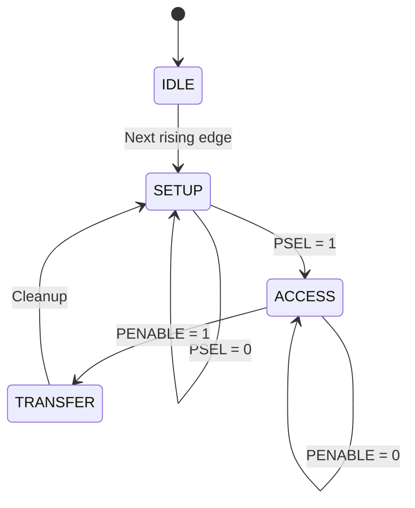
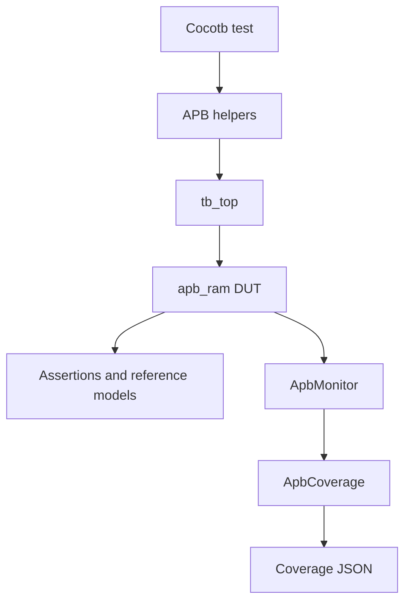

# APB RAM Verification Project

A complete ASIC/SoC design-verification project for a synchronous APB RAM peripheral using SystemVerilog, Cocotb, Python, Verilator, functional coverage, automated regression, and waveform debugging.

**Author:** Andrew Abdi

**Project status:** Verification and Phase 10 documentation complete; final release preparation pending.

---

## Project Overview

This project implements and verifies a 32-word × 32-bit APB RAM slave.

The project demonstrates a complete verification workflow:

- Verification planning
- SystemVerilog RTL development
- Cocotb testbench development
- Directed verification
- Corner-case and negative testing
- Randomized verification
- Python reference-model checking
- Stress testing
- APB behavior characterization
- Functional coverage
- Verilator code coverage
- Automated regression
- Regression reporting
- Waveform debugging
- Coverage-hole analysis
- Technical documentation

---

## Final Results

| Metric | Result |
|---|---:|
| Total regression tests | 32 |
| Passed | 32 |
| Failed | 0 |
| Skipped | 0 |
| Regression pass rate | 100% |
| Functional coverage | 119/119 bins, 100% |
| Verilator code coverage | 59/59 points, 100% |
| Known critical functional bugs | 0 |

```text
Total: 32  Passed: 32  Failed: 0  Skipped: 0
```

---

## Design Under Test

The DUT is a synchronous APB slave containing:

```systemverilog
logic [31:0] mem [0:31];
```

This provides:

- 32 memory locations
- 32 bits per location
- 1,024 total bits
- 128 total bytes

### DUT Features

- APB read transactions
- APB write transactions
- Synchronous active-low reset
- Ready signaling through `pready`
- Illegal-address detection
- Error signaling through `pslverr`
- Four-state control FSM
- Direct RAM word-index addressing

### Address Behavior

| Address | Classification | Result |
|---:|---|---|
| `0–31` | Legal | Accesses `mem[0]` through `mem[31]` |
| `32` or greater | Illegal | Asserts `pslverr` |

`paddr` is used directly as a word index. It is not translated from a byte address.

---

## APB Interface

| Signal | Direction | Width | Description |
|---|---|---:|---|
| `pclk` | Input | 1 | APB clock |
| `presetn` | Input | 1 | Synchronous active-low reset |
| `psel` | Input | 1 | Slave-select signal |
| `penable` | Input | 1 | ACCESS-phase signal |
| `pwrite` | Input | 1 | Write when high and read when low |
| `paddr` | Input | 32 | Direct RAM word index |
| `pwdata` | Input | 32 | Write data |
| `prdata` | Output | 32 | Read data |
| `pready` | Output | 1 | Transfer-completion signal |
| `pslverr` | Output | 1 | Illegal-access error signal |

For detailed protocol behavior, see [APB Protocol](docs/apb_protocol.md).

---

## RTL State Machine

The DUT uses four two-bit states:

| State | Encoding | Purpose |
|---|---|---|
| `IDLE` | `2'b00` | Reset and initial state |
| `SETUP` | `2'b01` | Waits for `psel` |
| `ACCESS` | `2'b10` | Waits for `penable` and completes the transfer |
| `TRANSFER` | `2'b11` | Clears completion and error outputs |



Reset is synchronous. The DUT responds to `presetn=0` on a rising edge of `pclk`.

---

## Active Verification Architecture



The active regression uses:

- APB helper functions in `tb_utils.py`
- Direct test assertions
- Local Python memory models
- `ApbMonitor`
- `ApbCoverage`
- Per-test XML results
- Per-test functional coverage JSON

### Monitoring

The monitor records a completed transfer when:

```text
psel && penable && pready
```

It captures:

- Transaction type
- Address
- Write or read data
- Slave-error value
- Simulation time

The monitor samples after Cocotb enters the read-only simulation phase, preventing checks from reading outputs before RTL updates have settled.

### Reusable Infrastructure

The repository also contains reusable UVM-inspired components:

- `ApbDriver`
- `ApbAgent`
- `ApbScoreboard`
- `ApbEnv`
- `RegressionEnv`
- Sequence classes
- SystemVerilog `apb_if`

These components demonstrate a reusable layered architecture, but they are not directly instantiated by the current 32-test regression.

See [Architecture](docs/architecture.md) for the complete active and reusable architecture description.

---

## Verification Strategy

The project combines several verification methods:

| Method | Purpose |
|---|---|
| Directed testing | Verifies known features with deterministic stimulus |
| Boundary testing | Verifies addresses 0 and 31 |
| Corner-case testing | Exercises reset timing, data patterns, and repeated operations |
| Negative testing | Verifies illegal accesses and incomplete transfers |
| Randomized testing | Exercises varying addresses, data, and operation order |
| Reference-model checking | Compares DUT contents against expected Python state |
| Stress testing | Applies sustained, repeated, and mixed traffic |
| Protocol characterization | Documents behavior under intentionally invalid master stimulus |
| Functional coverage | Measures verification-scenario completion |
| Code coverage | Measures executed RTL coverage points |
| Waveform debugging | Analyzes timing and state transitions |
| Automated regression | Runs and reports the complete test suite |

See [Verification Plan](docs/verification_plan.md) for the complete strategy.

---

## Test Regression

The Makefile organizes 32 tests into six groups:

| Group | Tests | Result |
|---|---:|---|
| `basic` | 10 | 10 passed |
| `corner` | 5 | 5 passed |
| `negative` | 5 | 5 passed |
| `random_tests` | 4 | 4 passed |
| `stress_tests` | 4 | 4 passed |
| `protocol` | 4 | 4 passed |
| **Total** | **32** | **32 passed** |

### Basic Tests

- Smoke test
- Reset test
- Address 0
- Address 31
- Default-memory read
- Overwrite
- Sequential write
- Sequential read
- Immediate write/read
- Random basic

### Corner-Case Tests

- Important data patterns
- Boundary-address toggle
- Repeated same-address access
- Reset during a transaction
- First access after reset

### Negative Tests

- Illegal write
- Illegal read
- SETUP without ACCESS
- Write data changed during a transfer
- Recovery after an illegal access

### Random Tests

- Random write/readback
- Random read/write mixture
- Random memory sweep
- Random illegal access

### Stress Tests

- Back-to-back traffic
- Repeated-address traffic
- Multiple full-memory cycles
- Long mixed read/write traffic

### Protocol-Characterization Tests

- `penable` asserted without `psel`
- `paddr` changed between SETUP and ACCESS
- `pwrite` changed between SETUP and ACCESS
- `pwdata` changed between SETUP and ACCESS

The signal-change tests intentionally violate APB master requirements. They characterize the current RTL response and are not tests proving legal APB master behavior.

For the complete test-by-test table, see [Test Summary](docs/test_summary.md).

---

## Reference-Model Checking

Random and stress tests maintain an expected Python representation of the RAM.

```text
Write transaction:
    Drive the DUT write
    Update the expected memory model

Read transaction:
    Read data from the DUT
    Compare it against the expected model value
```

This allows transaction order, address, data, and operation type to vary while maintaining deterministic checking.

---

## Functional Coverage

The functional coverage model contains 119 bins:

| Coverage group | Bins |
|---|---:|
| Read and write operations | 2 |
| Every legal address | 32 |
| Legal and illegal address types | 2 |
| Boundary addresses | 2 |
| `pslverr` values | 2 |
| Important write-data patterns | 8 |
| Transaction sequences | 2 |
| Operation × address type | 4 |
| Operation × every legal address | 64 |
| Reset observation | 1 |
| **Total** | **119** |

Final result:

```text
119/119 bins = 100%
```

The eight data-pattern bins are:

- `0x00000000`
- `0xFFFFFFFF`
- `0xAAAAAAAA`
- `0x55555555`
- `0x80000000`
- `0x00000001`
- `0x7FFFFFFF`
- `0xFFFFFFFE`

---

## Code Coverage

Verilator coverage is collected for every test and merged across the regression.

Final result:

```text
59/59 coverage points = 100.00%
```

The original planning goal was 95% RTL code coverage. The final regression achieved 100% of the Verilator coverage points included in the report, exceeding the original target.

The coverage results were obtained after completing coverage-hole analysis and excluding the structurally unreachable FSM default branch. All 32 regression tests passed, and functional coverage reached 119/119 bins (100%).

The reported 100% code coverage applies to Verilator's included coverage points and does not guarantee that every possible RTL behavior has been verified.

### Structurally Unreachable FSM Default

The FSM uses a two-bit state variable, and all four possible values are valid states:

```text
00 = IDLE
01 = SETUP
10 = ACCESS
11 = TRANSFER
```

Verilator uses two-state simulation for this design. An unknown or high-impedance state cannot be injected to reach the defensive default branch.

The default branch remains in the RTL for defensive coding but is excluded from Verilator coverage:

```systemverilog
/* verilator coverage_off */
default: state <= IDLE;
/* verilator coverage_on */
```

---

## Automated Regression Reporting

Each Cocotb simulation produces a result XML file.

The reporting script:

1. Reads the saved XML files.
2. Identifies passed, failed, and skipped tests.
3. Preserves the Makefile target and Cocotb test name.
4. Calculates final totals.
5. Writes a readable report.

Final report:

```text
results/regression_report.txt
```

Final totals:

```text
Total: 32  Passed: 32  Failed: 0  Skipped: 0
```

---

## Repository Structure

```text
apb-ram-verification/
├── docs/
│   ├── apb_protocol.md
│   ├── architecture.md
│   ├── development_journal.md
│   ├── phase5_basic_verification.md
│   ├── test_summary.md
│   ├── test_*.md
│   └── verification_plan.md
├── rtl/
│   ├── apb_if.sv
│   ├── apb_ram.sv
│   └── tb_top.sv
├── tb/
│   └── cocotb/
│       ├── agents/
│       ├── env/
│       ├── sequences/
│       └── tests/
├── scripts/
│   ├── merge_functional_coverage.py
│   └── regression_report.py
├── coverage/
├── logs/
├── results/
├── Makefile
└── README.md
```

Generated coverage directories include:

```text
coverage_runs/
functional_coverage/
```

---

## Prerequisites

The project was developed and verified with:

| Tool | Project environment |
|---|---|
| Operating system | Ubuntu 24.04 |
| Python | Python 3.12 virtual environment |
| Simulator | Verilator 5.040 |
| Verification framework | Cocotb |
| Build automation | GNU Make |
| Waveform viewer | GTKWave |
| Version control | Git and GitHub |

---

## Running the Project

Activate the Python environment before running the tests.

### Run One Test

```bash
make smoke
```

Other examples:

```bash
make reset
make addr0
make illegal_read
make random_memory_sweep
make stress
```

### Run One Test Group

```bash
make basic
make corner
make negative
make random_tests
make stress_tests
make protocol
```

### Run the Full Regression

```bash
make regress
```

### Generate the Regression Report

```bash
make regression-report
```

### Merge Code Coverage

Run the regression first, then:

```bash
make coverage
```

### Run Regression with Functional Coverage

```bash
make regress-functional-coverage
```

### Display the Functional Coverage Report

```bash
make functional-coverage
```

### Open the Waveform

```bash
gtkwave waves/dump.vcd
```

---

## Debugging Workflow

The debugging process used during this project was:

1. Run a focused Cocotb test.
2. Read assertion and log output.
3. Open the generated waveform in GTKWave.
4. Inspect APB phases and FSM transitions.
5. Identify whether the issue is in the RTL, stimulus, timing, or expected value.
6. Correct the issue.
7. Rerun the focused test.
8. Rerun the full regression.
9. Regenerate coverage and reports.

The Phase 9 exercise deliberately introduced an incorrect expected read value, observed the failure, used waveform inspection to identify the mismatch, restored the correct check, and confirmed that the regression passed again.

---

## Key Engineering Lessons

### Sample After RTL Updates

Cocotb checks should sample outputs after the simulator has applied nonblocking assignments. Using the `ReadOnly` trigger prevents race conditions and stale-value checks.

### Separate Legal Protocol Testing from Characterization

A test that intentionally changes `paddr`, `pwrite`, or `pwdata` between SETUP and ACCESS does not represent a legal APB master. Such tests are useful for documenting RTL behavior, but they should not be described as protocol-compliance tests.

### Functional and Code Coverage Answer Different Questions

One hundred percent functional coverage confirms that every planned functional bin was exercised. It does not guarantee 100% RTL code coverage.

### Coverage Holes Require Analysis

A missed coverage point may indicate:

- Missing stimulus
- An untested error path
- A testbench limitation
- Structurally unreachable logic
- A simulator-specific limitation

The correct response is to investigate the hole before adding stimulus or excluding logic.

### Regression Results Must Be Preserved

Saving per-test XML files makes the regression auditable and allows an automated summary to be created after all tests finish.

### Active and Reusable Components Must Be Distinguished

Reusable drivers, agents, scoreboards, environments, and sequences exist in the repository, but documentation should distinguish them from the helper-driven path that actually runs in the current regression.

Additional weekly lessons are recorded in [Development Journal](docs/development_journal.md).

---

## Project Documentation

| Document | Description |
|---|---|
| [APB Protocol](docs/apb_protocol.md) | APB phases, signals, timing, read/write transfers, errors, and reset |
| [Architecture](docs/architecture.md) | DUT, FSM, memory organization, active verification flow, coverage, and reusable components |
| [Verification Plan](docs/verification_plan.md) | Final verification objectives, strategy, coverage plan, exit criteria, and results |
| [Test Summary](docs/test_summary.md) | All 32 tests organized by group with objectives and results |
| [Development Journal](docs/development_journal.md) | Weekly progress, engineering decisions, challenges, and lessons learned |
| [Phase 5 Summary](docs/phase5_basic_verification.md) | Basic directed-verification milestone |
| Individual test documents | Focused documentation for foundational tests |

---

## Skills Demonstrated

- SystemVerilog RTL
- APB protocol verification
- Cocotb test development
- Python verification utilities
- Directed verification
- Randomized verification
- Reference-model development
- Negative and corner-case testing
- Stress testing
- Transaction monitoring
- Functional coverage
- Code-coverage analysis
- Regression automation
- Automated result reporting
- Waveform debugging
- Linux command-line workflow
- Git version control
- Technical documentation

---

## Current Limitations

- Fixed 32-word memory depth
- Fixed 32-bit data width
- Direct word-index addressing
- One APB master and one APB slave
- No programmable wait states
- No overlapping transfers
- No APB4 `PSTRB` or `PPROT`
- Reusable agent, environment, scoreboard, and sequence classes are not integrated into the active regression
- Verification is simulation-based and does not include formal or hardware validation

---

## Optional Future Enhancements

- Integrate the reusable agent, environment, scoreboard, and sequences
- Add SystemVerilog Assertions for APB protocol properties
- Add a second-simulator regression
- Add continuous-integration automation
- Parameterize memory depth and data width
- Add programmable wait states
- Add APB4 signals
- Add partial-write support
- Add random-reset insertion
- Add formal property checking

---

## Project Status

| Area | Status |
|---|---|
| RTL development | Complete |
| Testbench development | Complete |
| Functional verification | Complete |
| Functional coverage | Complete — 100% |
| Code-coverage analysis | Complete — 100% |
| Regression automation | Complete |
| Waveform debugging | Complete |
| Architecture documentation | Complete |
| Verification plan | Complete |
| Test summary | Complete |
| Final README project report | Complete |
| Release preparation | Next |

---

## Author

**Andrew Abdi**

ASIC / SoC Design Verification

SystemVerilog • Cocotb • Python • APB • Verilator • Linux • Git
