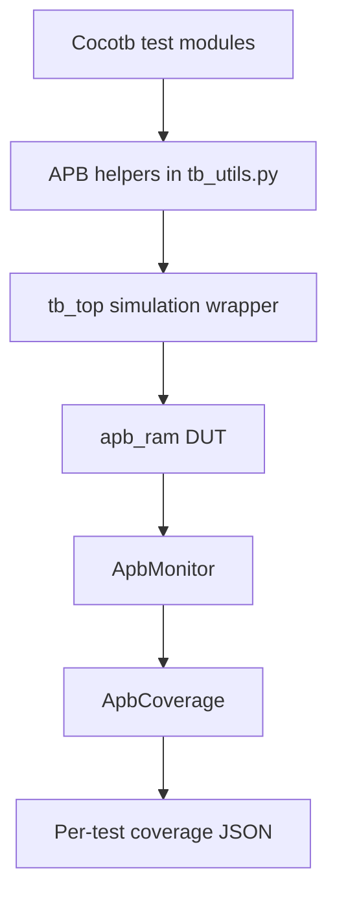
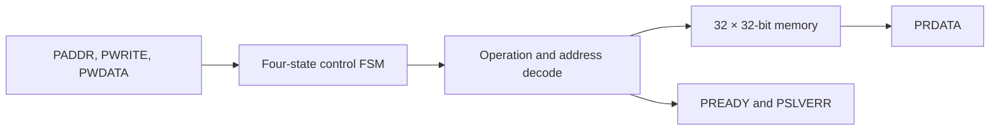
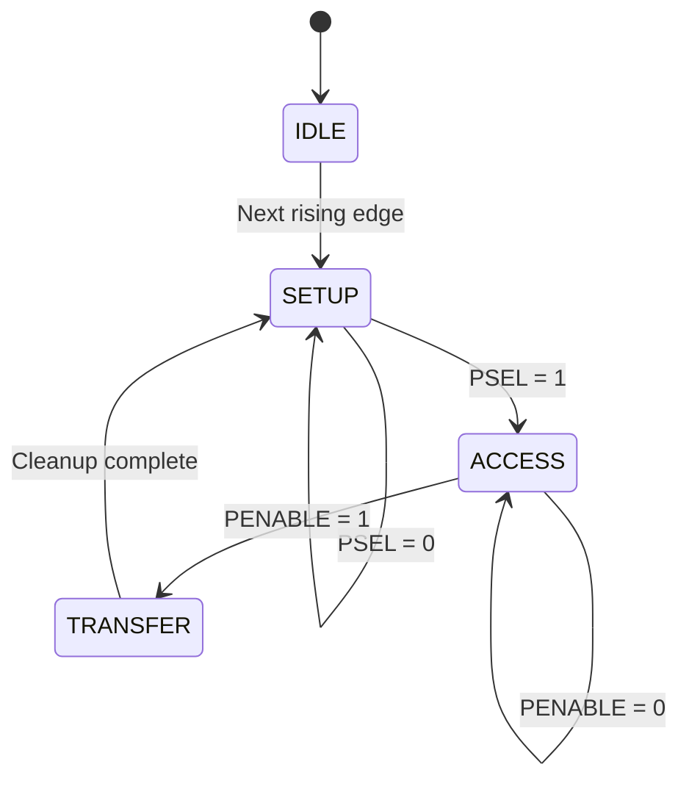
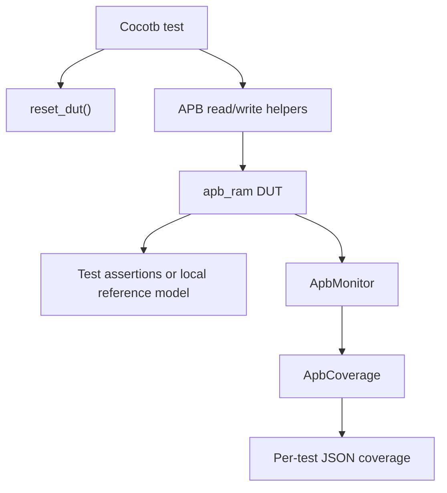

# APB RAM Architecture

**Project:** APB RAM Verification using Cocotb and Verilator
**Author:** Andrew Abdi
**Document Version:** 1.0
**Date:** October 5, 2026

---

## 1. Overview

This document describes the design and verification architecture of the APB RAM project.

The Device Under Test (DUT) is a synchronous APB slave containing a 32-word × 32-bit memory. The design supports read and write transfers, synchronous active-low reset, illegal-address detection, ready signaling, and slave-error generation.

The verification environment uses Cocotb and Python to drive the SystemVerilog DUT, monitor completed transfers, collect functional coverage, check expected behavior, preserve regression results, and generate waveform data for debugging.

---

## 2. System Architecture



The current test suite uses helper functions in `tb_utils.py` to drive the APB signals directly. `ApbMonitor` observes completed transactions and publishes them to the functional coverage collector.

Individual tests use assertions or local reference models to check DUT behavior.

---

## 3. RTL Components

| File | Purpose |
|---|---|
| `rtl/apb_ram.sv` | Implements the APB RAM, memory array, control FSM, reset behavior, reads, writes, and error handling |
| `rtl/tb_top.sv` | Provides the top-level simulation wrapper and connects Cocotb-visible signals to the DUT |
| `rtl/apb_if.sv` | Defines a reusable SystemVerilog APB interface; it is not instantiated by the current `tb_top` |

### 3.1 Simulation Wrapper

`tb_top.sv` declares the APB signals and connects them directly to the `apb_ram` instance.

The wrapper does not generate the clock, apply reset, call `$finish`, or control simulation time. Cocotb owns clock generation, stimulus, checking, and simulation termination.

Waveform tracing is enabled through the simulator and Makefile flow rather than through an `initial` block in `tb_top.sv`.

---

## 4. DUT Interface

| Signal | Direction | Width | Description |
|---|---|---:|---|
| `pclk` | Input | 1 | APB clock |
| `presetn` | Input | 1 | Synchronous active-low reset |
| `psel` | Input | 1 | Selects the APB slave during SETUP |
| `penable` | Input | 1 | Indicates the ACCESS phase |
| `pwrite` | Input | 1 | Selects write when high and read when low |
| `paddr` | Input | 32 | Direct RAM word index |
| `pwdata` | Input | 32 | Write data |
| `prdata` | Output | 32 | Read data |
| `pready` | Output | 1 | Indicates transfer completion |
| `pslverr` | Output | 1 | Indicates an illegal access |

---

## 5. Memory Organization

The DUT contains the following memory array:

```systemverilog
logic [31:0] mem [0:31];
```

This represents:

- 32 memory locations
- 32 bits per location
- 1,024 total bits
- 128 total bytes

### 5.1 Address Interpretation

Although `paddr` is 32 bits wide, the RTL uses it directly as a word index.

| Address value | Classification | Result |
|---:|---|---|
| `0–31` | Legal | Accesses `mem[0]` through `mem[31]` |
| `32` or greater | Illegal | Raises `pslverr` |

The design does not interpret `paddr` as a byte-aligned address. For example, address `1` selects the second 32-bit word directly.

---

## 6. DUT Datapath



During a completed ACCESS phase, the control logic selects either the read path or write path and determines whether the address is legal.

---

## 7. Finite-State Machine

The control FSM uses a two-bit enumerated state variable with four valid encodings:

| State | Encoding | Purpose |
|---|---|---|
| `IDLE` | `2'b00` | Reset and initial state |
| `SETUP` | `2'b01` | Waits for `psel` |
| `ACCESS` | `2'b10` | Waits for `penable` and performs the transfer |
| `TRANSFER` | `2'b11` | Clears completion and error signals before returning to `SETUP` |



When `presetn` is low at a rising edge of `pclk`, the synchronous reset overrides normal state transitions and returns the FSM to `IDLE`.

The FSM normally follows:

```text
IDLE → SETUP → ACCESS → TRANSFER → SETUP
```

It does not normally return to `IDLE` between transfers.

---

## 8. Reset Behavior

Reset is active-low and synchronous:

```systemverilog
always_ff @(posedge pclk) begin
    if (!presetn) begin
        ...
    end
end
```

When `presetn` is low on a rising edge of `pclk`, the DUT:

- Sets the FSM state to `IDLE`
- Clears `prdata`
- Deasserts `pready`
- Deasserts `pslverr`
- Clears all 32 memory locations to zero

Because reset is synchronous, asserting `presetn = 0` does not update the DUT immediately. The reset operation occurs on the next active clock edge.

---

## 9. Write Behavior

A write is performed when the FSM is in `ACCESS`, `penable` is high, and `pwrite` is high.

### 9.1 Legal Write

When `paddr < 32`:

- `pwdata` is written into `mem[paddr]`
- `pready` is asserted
- `pslverr` is deasserted
- The FSM moves to `TRANSFER`

### 9.2 Illegal Write

When `paddr >= 32`:

- Memory is not modified
- `pready` is asserted
- `pslverr` is asserted
- The FSM moves to `TRANSFER`

---

## 10. Read Behavior

A read is performed when the FSM is in `ACCESS`, `penable` is high, and `pwrite` is low.

### 10.1 Legal Read

When `paddr < 32`:

- `mem[paddr]` is placed on `prdata`
- `pready` is asserted
- `pslverr` is deasserted
- The FSM moves to `TRANSFER`

### 10.2 Illegal Read

When `paddr >= 32`:

- `prdata` is set to `32'hXXXXXXXX`
- `pready` is asserted
- `pslverr` is asserted
- The FSM moves to `TRANSFER`

The Cocotb monitor handles the unknown read value by storing `None` in the observed transaction rather than converting the unknown value to an integer.

---

## 11. APB Timing Behavior

The legal helper-driven transaction sequence is:

| Cycle | Phase | Important signals |
|---:|---|---|
| 1 | SETUP | `psel=1`, `penable=0`, address/control/data driven |
| 2 | ACCESS | `psel=1`, `penable=1` |
| 3 | TRANSFER/Cleanup | DUT clears `pready` and `pslverr` |
| 4 | Bus idle or next setup | Helper deasserts or prepares control signals |

The test helpers wait for RTL updates and use Cocotb’s `ReadOnly` trigger before sampling outputs.

### 11.1 Signal Stability

A legal APB master keeps address, direction, and write data stable between SETUP and ACCESS.

The protocol-characterization tests intentionally violate these requirements by changing:

- `paddr`
- `pwrite`
- `pwdata`

The RTL does not latch these signals during SETUP. It samples their current values when the transfer completes in ACCESS. These tests characterize existing RTL behavior; they do not define legal APB master behavior.

### 11.2 Select and Enable Behavior

The RTL checks:

- `psel` while in `SETUP`
- `penable` while in `ACCESS`

After entering `ACCESS`, transfer completion is gated by `penable`; the RTL does not perform an additional `psel` check in that state.

---

## 12. Active Verification Architecture



### 12.1 Stimulus

Current tests use functions from `tb/cocotb/tests/tb_utils.py`:

- `reset_dut()`
- `apb_write()`
- `apb_read()`
- `initialize_memory_pattern()`
- `apb_read_expect_error()`
- `apb_write_expect_error()`

These helpers drive the DUT signals directly.

### 12.2 Monitoring

`ApbMonitor` samples the DUT on every rising edge of `pclk` after entering Cocotb’s read-only simulation phase.

A completed transfer is recorded when:

```text
psel && penable && pready
```

The monitor captures:

- Transaction type
- Address
- Write or read data
- Slave-error value
- Simulation time

Reset is recorded once when `presetn` transitions from high to low.

### 12.3 Checking

The active tests use:

- Direct assertions
- Expected-value comparisons
- Local software memory models for randomized and stress tests

A reusable `ApbScoreboard` exists in the repository, but it is not directly instantiated by the current 32-test regression.

### 12.4 Functional Coverage

`reset_dut()` starts one monitor and one functional coverage collector for each test simulation.

The monitor publishes every observed transaction to a subscribed callback:

```text
ApbMonitor → sample_transaction() → ApbCoverage
```

After each transaction, the coverage collector exports:

```text
functional_coverage/tests/<test_name>.json
```

The per-test JSON files are later merged into the final functional coverage report.

---

## 13. Functional Coverage Model

| Coverage group | Number of bins | Purpose |
|---|---:|---|
| Operation | 2 | Read and write |
| Legal address | 32 | Every RAM address from 0 through 31 |
| Address type | 2 | Legal and illegal |
| Boundary | 2 | Address 0 and address 31 |
| Error | 2 | `pslverr=0` and `pslverr=1` |
| Data pattern | 8 | Important 32-bit write patterns |
| Sequence | 2 | Back-to-back and write/read-same-address |
| Operation × address type | 4 | Legal and illegal reads and writes |
| Operation × legal address | 64 | Read and write coverage for every legal address |
| Reset | 1 | Reset observation |
| **Total** | **119** | |

The eight data-pattern bins are:

- `0x00000000`
- `0xFFFFFFFF`
- `0xAAAAAAAA`
- `0x55555555`
- `0x80000000`
- `0x00000001`
- `0x7FFFFFFF`
- `0xFFFFFFFE`

Final merged functional coverage:

```text
119/119 bins = 100%
```

---

## 14. Reusable Framework Components

The repository also contains UVM-inspired reusable infrastructure.

| Component | Location | Current status |
|---|---|---|
| `ApbDriver` | `agents/apb_driver.py` | Defined but not used by the current test regression |
| `ApbAgent` | `env/agent.py` | Defined as a driver/monitor container |
| `ApbScoreboard` | `env/scoreboard.py` | Defined but not directly instantiated by the current tests |
| `ApbEnv` | `env/env.py` | Defined but not referenced by the current tests |
| `RegressionEnv` | `env/regression.py` | Available through `build_env()` but not referenced by the current tests |
| Sequence classes | `sequences/` | Defined but not instantiated by the current tests |
| `apb_if` | `rtl/apb_if.sv` | Defined but not instantiated by `tb_top.sv` |

These components demonstrate the intended layered architecture but should not be described as part of the active regression path unless they are integrated and rerun successfully.

---

## 15. Code-Coverage Exclusion

The RTL contains a defensive default FSM branch:

```systemverilog
default: state <= IDLE;
```

The state variable is two bits wide, and all four possible two-bit values are assigned to valid states:

```text
00 = IDLE
01 = SETUP
10 = ACCESS
11 = TRANSFER
```

Verilator uses two-state simulation for this design, so an unknown or high-impedance state cannot be injected to reach the default branch.

The branch is therefore structurally unreachable in the current simulation environment and is excluded from code coverage using:

```systemverilog
/* verilator coverage_off */
default: state <= IDLE;
/* verilator coverage_on */
```

Final merged Verilator code coverage:

```text
56/59 coverage points = 94%
```

---

## 16. Current Design Constraints

The current implementation assumes:

- One APB master
- One APB slave
- One transaction at a time
- No overlapping transfers
- No programmable wait-state insertion
- Direct word-index addressing
- A fixed memory depth of 32 words
- A fixed data width of 32 bits
- APB control signals without APB4 extensions such as `PSTRB` or `PPROT`

---

## 17. Architecture Summary

The project combines a small synchronous APB RAM with a Cocotb-based verification flow.

The active regression uses direct APB helper functions, transaction monitoring, functional coverage callbacks, test assertions, local reference models, grouped Makefile targets, XML result preservation, and automated regression reporting.

The final verified results are:

| Metric | Result |
|---|---:|
| Regression | 32/32 tests passed |
| Functional coverage | 119/119 bins, 100% |
| Verilator code coverage | 56/59 points, 94% |
| Failed tests | 0 |
| Skipped tests | 0 |
